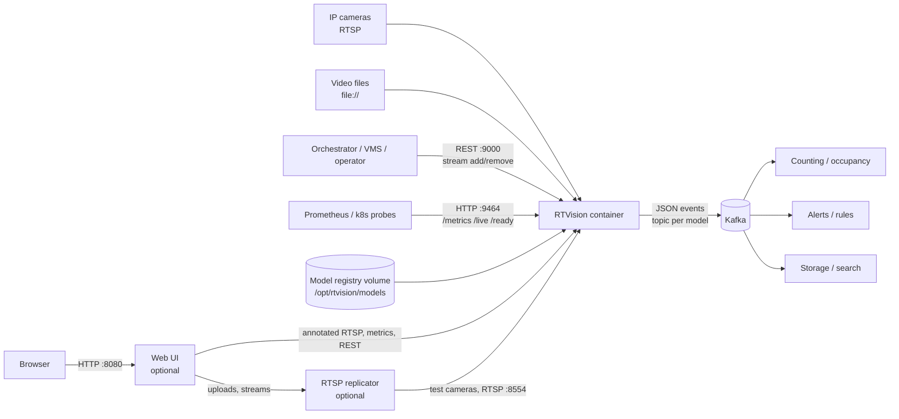
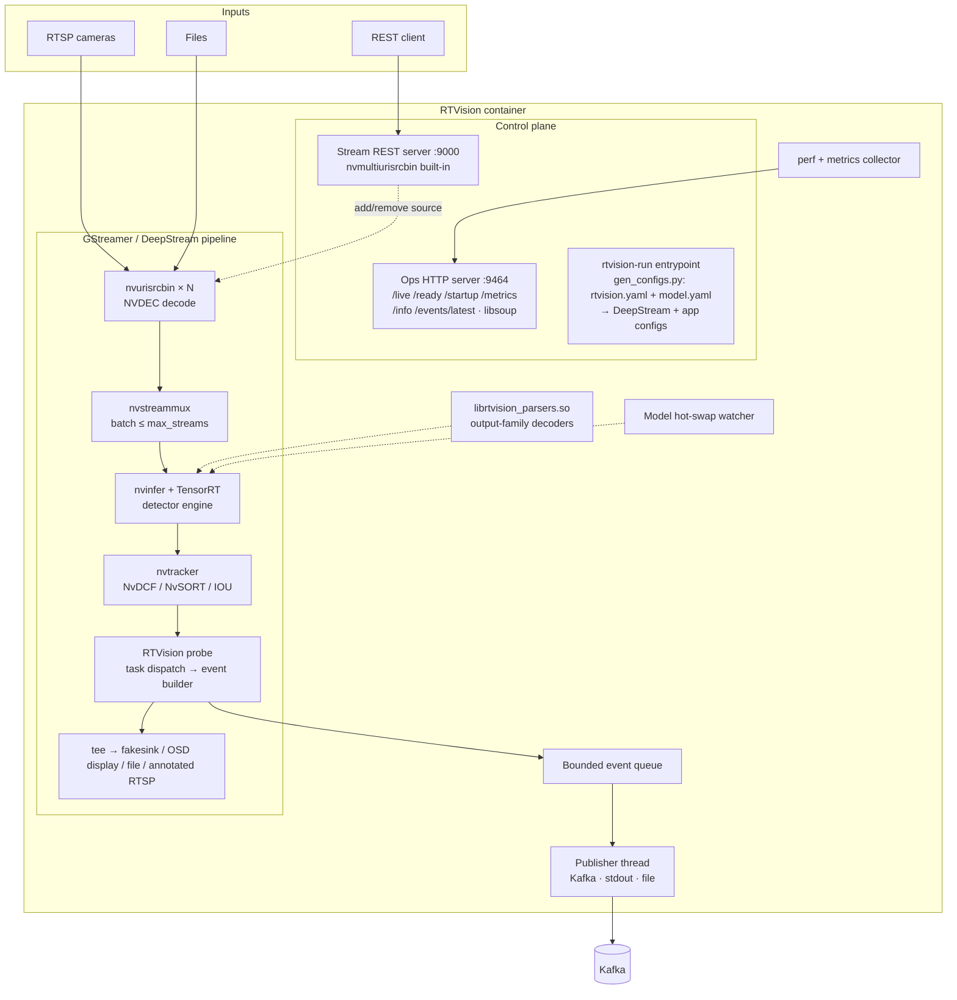
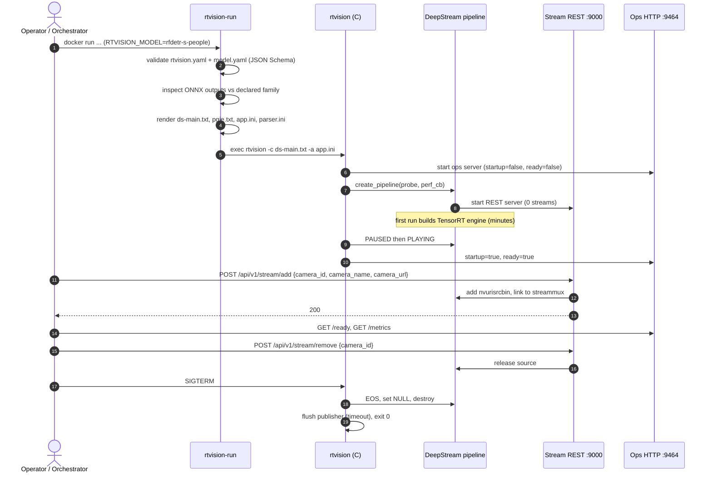
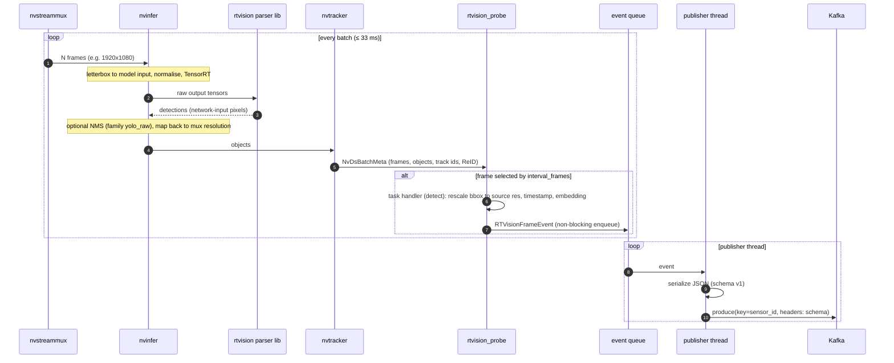

<!-- SPDX-License-Identifier: Apache-2.0 -->
# RTVision — Architecture

**RTVision** is a real-time, multi-stream video perception microservice. It ingests many camera streams (RTSP or files) that are added and removed at runtime through a REST API. It runs a **configurable object-detection model** on the GPU, tracks objects across frames, and publishes one structured JSON event per sampled frame to Kafka (or stdout/file).

- **v1 scope:** 2D object detection + multi-object tracking.
- **Designed-in extension points:** instance segmentation, pose, secondary classifiers, zone/line analytics (see [docs/ROADMAP.md](docs/ROADMAP.md)).

The architecture is derived from NVIDIA's RT-CV microservice (`services/rtvi/rt-cv` in `NVIDIA-AI-Blueprints/video-search-and-summarization`, Apache-2.0). RTVision keeps RT-CV's proven runtime shape and replaces the model-specific and closed-schema parts with generic, configurable and open components.

> Status: implemented (v0.1.0). Where the implementation differs from this document's original text, [docs/DEVIATIONS.md](docs/DEVIATIONS.md) says so. The build history and acceptance results are in [docs/IMPLEMENTATION_PLAN.md](docs/IMPLEMENTATION_PLAN.md).

---

## 1. Goals and non-goals

### Goals
1. **Many streams per GPU:** batched inference over all active cameras, with frames kept in GPU memory end to end (NVIDIA DeepStream + TensorRT).
2. **Dynamic cameras:** add and remove streams at runtime over REST, with no restart.
3. **Model-agnostic detection:** any detector exportable to ONNX whose output matches a supported *output family*, selected by a `model.yaml` file. No code change is needed for new weights of a supported family.
4. **Stable identities:** tracker-assigned `track_id` per object, with optional ReID embeddings.
5. **Open, versioned event schema:** owned by this project, JSON, documented, validated by JSON Schema.
6. **Production operations:** health probes, Prometheus metrics, structured logs, graceful shutdown, live model swap.
7. **Clean licensing:** an Apache-2.0 repository with no vendored proprietary code or model weights (see [docs/LICENSING.md](docs/LICENSING.md)).

### Non-goals (v1)
- Request/response single-image inference API.
- Video storage, recording or a VMS. (The optional web UI shows live streams and figures; it is not a VMS.)
- Non-NVIDIA hardware (an open-source backend is a roadmap item).
- Segmentation, pose or 3D in v1. Interfaces are reserved, but those tasks are not implemented.

---

## 2. System context

The web UI and the replicator are separate, optional containers (`deploy/compose/compose.ui.yaml`).
RTVision does not depend on them.

---

## 3. Container architecture (block diagram)

### 3.1 Component responsibilities

| Component | Source | Responsibility |
|---|---|---|
| `rtvision-run` (Python) | new | Entrypoint. Validates `rtvision.yaml` and `model.yaml` against JSON Schemas, inspects the ONNX output shapes, generates DeepStream configs and `app.ini`, sets env vars, then `exec`s the C binary. |
| `rtvision` (C binary) | derived from RT-CV `metropolis_perception_app.c` | Pipeline lifecycle, CLI, signal handling, probe registration, perf callback, model hot-swap thread. |
| Stream REST server | DeepStream `nvmultiurisrcbin` | `POST /api/v1/stream/add`, `POST /api/v1/stream/remove` (DeepStream's documented payload). |
| Ops HTTP server | new (libsoup-3.0) | `/live`, `/ready`, `/startup`, `/metrics` (Prometheus text format), `/info`, `/events/latest` (last event per camera). Runs independently of DeepStream's REST server. |
| `nvinfer` + parser library | DeepStream + new `librtvision_parsers.so` | Pre-processing (resize, letterbox, normalise), TensorRT inference, and output decoding by family. |
| `nvtracker` | DeepStream | Track IDs; optional ReID features. Profile chosen in config. |
| Probe + event builder | new (ideas ported from RT-CV) | Per-frame sampling, bbox rescaling to source resolution, timestamps, embeddings, task dispatch, event structs. |
| Serializer | new (GLib only) | Event struct → JSON matching `schemas/detection_event.v1.schema.json`. |
| Publisher | new (librdkafka) | Bounded async queue, background thread, backends (`kafka`, `stdout`, `file`), drop policy, delivery metrics. Remembers the last event per camera for `/events/latest`. |
| Web UI `rtvision-ui` (Python, optional) | new (standard library; GStreamer for video) | Live annotated streams, performance and hardware figures, camera add/remove, replicator management. See [docs/UI.md](docs/UI.md). |
| RTSP replicator `rtvision-replicator` (Python, optional) | new (GStreamer RTSP server) | Serves video files as looping, real-time RTSP cameras for tests and demos. See [docs/REPLICATOR.md](docs/REPLICATOR.md). |

### 3.2 What was kept, changed and dropped vs RT-CV

| RT-CV element | RTVision | Reason |
|---|---|---|
| nvmultiurisrcbin, nvstreammux, nvinfer, nvtracker | **kept** | Proven multi-stream GPU path. |
| `bbox_generated_probe_after_analytics` | **rewritten** as `rtvision_probe` with task dispatch | Removes the hard-coded model enum (`-m 0..7`); adds an extension point for segmentation. |
| `nvmsgconv` + `nvmsgbroker` (mega2d/mega protobuf) | **replaced** by own serializer + librdkafka publisher | The schema belongs to this project, is documented, and can carry masks later; avoids depending on closed converter libraries. |
| `msgapi_init_early`, `g_nvds_last_error_message` | **dropped** | They come from NVIDIA's internal RTVI base image, not public DeepStream. Startup errors go to logs and `/startup`. |
| Health endpoints on the stream REST server | **moved** to our own ops server | Not guaranteed in public DeepStream; our server also serves metrics. |
| Sparse4D, Grounding DINO/Triton, FSL, SGIE demo code | **dropped** | Out of scope for detection v1. |
| Hand-edited per-model config folders | **replaced** by `model.yaml` + generator | One source of truth; no batch-size drift across files. |
| ReID embedding cache, NTP/URI-UTC timestamps, force-TCP RTSP, OTA watcher, perf callback | **ported** | Proven behaviour. |

---

## 4. Runtime workflows

### 4.1 Startup and stream management (control plane)

### 4.2 Per-frame processing (data plane)

The probe runs on the streaming thread, so it **must never block**. Serialization and network I/O happen on the publisher thread. When the queue is full, the configured policy applies (`drop_oldest` by default) and `rtvision_events_dropped_total` is incremented.

---

## 5. Model abstraction

### 5.1 Tasks and output families

`model.yaml` declares a **task** and an **output family**. The C probe dispatches on the task; the parser library dispatches on the family.

| Task | v1 status | DeepStream mechanism |
|---|---|---|
| `detect` | **implemented** | `nvinfer` `network-type=0` + custom bbox parser |
| `segment` | reserved | `nvinfer` `network-type=3`, `output-instance-mask=1`, `parse-bbox-instance-mask-func-name` |
| `pose` | reserved | tensor-meta output + custom post-processing |

| Family | Expected output | Example models | Clustering |
|---|---|---|---|
| `yolo_e2e` | 1 tensor `[K, 6]` = x1, y1, x2, y2, score, class in network-input pixels | Ultralytics YOLO26 (default NMS-free head), YOLOv10 | none (`cluster-mode=4`) |
| `yolo_raw` | 1 tensor `[4 + C, A]` (or transposed `[A, 4 + C]`) = cx, cy, w, h + class scores | YOLOv8 / YOLO11, YOLO26 with `end2end=False` | nvinfer NMS (`cluster-mode=2`) |
| `detr` | boxes `[Q, 4]` + logits `[Q, C]`; box format and activation configurable | RT-DETR, RF-DETR, D-FINE | none |
| `efficient_nms` | `num_dets`, `boxes`, `scores`, `classes` (TensorRT EfficientNMS plugin outputs) | many exported YOLO / SSD models | none |

The full parser contract is in [docs/PARSERS.md](docs/PARSERS.md), and the `model.yaml` format in [docs/CONFIGURATION.md](docs/CONFIGURATION.md).

### 5.2 Parser library design

- `src/parsers/core/` — **pure C++17, no DeepStream headers.** Decoders take raw float buffers plus shapes plus `ParseParams` and return `std::vector<Detection>`. They are unit-tested in CI without a GPU.
- `src/parsers/ds_adapter.cpp` — thin DeepStream adapter exporting `NvDsInferParseRTVision_<Family>` functions (`CHECK_CUSTOM_PARSE_FUNC_PROTOTYPE`).
- Family parameters such as layer names, box format and activation come from `parser.ini`. The generator writes this file and the adapter reads it once, via env var `RTVISION_PARSER_CONFIG`. nvinfer has no way to pass custom parameters to a parser, so this file is the channel.

### 5.3 Model hot swap

The RT-CV OTA mechanism is ported: an inotify watcher on an override file triggers `g_object_set(pgie, "config-file-path", …)` (or `model-engine-file`). The pipeline keeps running, and the result is logged and counted in metrics. The new model must keep the same task, family and input size; for anything else, restart.

---

## 6. Data contracts

- **Events:** [docs/EVENT_SCHEMA.md](docs/EVENT_SCHEMA.md) and `schemas/detection_event.v1.schema.json`. One message per sampled frame per stream, keyed by `sensor.id`.
- **REST:** [docs/API.md](docs/API.md).
- **Config:** [docs/CONFIGURATION.md](docs/CONFIGURATION.md), `schemas/service_config.schema.json`, `schemas/model.schema.json`.

Schema versioning: the `schema` field is `rtvision.detection.v1`. Additive optional fields keep v1. Breaking changes create `v2`, published on a new topic or under a header flag.

---

## 7. Timestamps

Per-stream source, selected in `rtvision.yaml` (`timestamps.source`):

| Source | Use case | Origin |
|---|---|---|
| `ntp` (default for RTSP) | live cameras | `frame_meta->ntp_timestamp` from RTCP sender reports; warn if it goes backwards |
| `uri_utc` | recorded files named `…__M_DD_YYYY_H_MIN_SEC_MSEC_AM_UTC±HH_MM.mp4` | ported `perception_utc.c` + buffer PTS |
| `system` | fallback / testing | wall clock when the probe runs |

Format: RFC 3339 UTC with milliseconds, e.g. `2026-11-20T06:30:00.123Z`. The event's `timestamp_source` records which source was used.

---

## 8. Observability

| Metric (Prometheus) | Type | Labels |
|---|---|---|
| `rtvision_stream_fps` | gauge | `sensor_id` |
| `rtvision_streams_active` | gauge | — |
| `rtvision_frames_processed_total` | counter | `sensor_id` |
| `rtvision_objects_detected_total` | counter | `sensor_id`, `label` |
| `rtvision_events_enqueued_total` / `_published_total` / `_dropped_total` / `_failed_total` | counter | — |
| `rtvision_publish_queue_depth` | gauge | — |
| `rtvision_model_info` | gauge (=1) | `name`, `version`, `task`, `family`, `precision` |
| `rtvision_model_swaps_total` | counter | `result` |

Health endpoints:
- `/startup` → 200 once the configs are parsed and the pipeline reaches PLAYING.
- `/ready` → 200 while PLAYING and the publisher is connected (or the backend is not Kafka).
- `/live` → 200 if the main-loop heartbeat is younger than 10 s (and while the service is still starting).
- `/info` → service, model and limits; `/events/latest` → last event of every camera (used by the web UI).

Logs are line-oriented `key=value`, with levels `error|warn|info|debug`.

---

## 9. Deployment

- **Base image:** public `nvcr.io/nvidia/deepstream:9.1-samples-multiarch` (configurable `ARG`). Two-stage Dockerfile: the build stage compiles the C binary and the parser library against the DeepStream sources/headers in the image; the runtime stage holds the binaries, Python tools and runtime libs.
- **Runs as non-root (uid 1000).**
- **Volumes:** `/opt/rtvision/models` (ONNX, labels, `model.yaml`), `/opt/rtvision/engines` (TensorRT engine cache), `/opt/rtvision/config` (`rtvision.yaml`).
- **Ports:** `9000` stream REST, `9464` ops/metrics. With the UI overlay also `8080` (web UI) and `8554` (replicated RTSP streams). Compose binds all of them to `127.0.0.1` by default.
- **Compose stack** for development and integration tests: `kafka` (apache/kafka, KRaft) + `rtvision`. The overlay `compose.ui.yaml` adds `ui` and `replicator`, which run from the same image with other commands.
- **Hardware:** NVIDIA dGPU on x86_64 (v1 target). Jetson and ARM SBSA are roadmap items (the same image family is multi-arch, but they are not validated in v1).

---

## 10. Performance and capacity guidance

- Throughput is bounded by the TensorRT engine. Start with FP16, a batch equal to `service.max_streams`, and a 640×640 input for YOLO-class models.
- `inference.interval` > 0 skips detector frames; the tracker fills in the gaps (big savings at a small accuracy cost).
- Event volume = streams × (fps / `interval_frames`). The default of 30 frames ≈ 1 event per second per stream.
- Measured (RTX 5070 Ti Laptop GPU, RF-DETR Small FP16, 512×512): 4 × 30 FPS at 22–26 % GPU load without the UI; 4 × 60 FPS with the UI and annotated output at about 32 %.
- Embeddings increase message size a lot (e.g. 256 floats ≈ 1.4 KB base64 per object). They are off by default.

---

## 11. Security

- The REST and ops ports are unauthenticated (DeepStream's REST server has no auth). Bind them to internal networks; put an authenticating gateway in front if they are exposed. `service.http_ip` defaults to `0.0.0.0` in containers; document the risk.
- The web UI has no login either. It requires a custom header for changes (CSRF), checks the `Host` header (DNS rebinding), sends a strict content security policy and never shows camera URLs. Put an authenticating reverse proxy in front of it before opening it to other machines.
- Kafka: support SASL/TLS through passthrough of librdkafka properties (`publish.kafka.properties`).
- No secrets in the repo; read credentials from env or files.
- Validate `camera_url` schemes (`rtsp`, `rtsps`, `file`, `http(s)`); reject others in our documentation and the orchestrator. Note that DeepStream's REST server accepts any URI.

---

## 12. Key decisions (ADR summary)

| # | Decision | Alternatives | Rationale |
|---|---|---|---|
| 1 | Build on public NVIDIA DeepStream 9.1 | pure GStreamer + ONNX Runtime | Zero-copy batching, tracker and REST source management come proven; fastest path to production. An open-source backend is a roadmap item. |
| 2 | Fork RT-CV app logic (Apache-2.0), compile against DeepStream's in-image `deepstream-app` sources (not vendored) | write from scratch on `deepstream-test5` | Proven lifecycle code with a clear licence; nothing proprietary in the repo. |
| 3 | Own JSON schema + librdkafka publisher | nvmsgconv/nvmsgbroker | Schema ownership, extensibility (masks), testability, fewer closed dependencies. |
| 4 | Per-frame events (objects array) | per-object events (RT-CV style) | Fewer messages, natural for counting/occupancy, atomic per frame. |
| 5 | `model.yaml` + generator | hand-written DeepStream configs | Single source of truth; validation; licence metadata per model. |
| 6 | Parser core free of DeepStream headers | parser directly on DeepStream types | Unit-testable in CI without a GPU; reusable by a future open-source backend. |
| 7 | Ops server separate from the stream REST server | rely on DeepStream REST health routes | Public DeepStream does not guarantee health routes; we need metrics anyway. |
| 8 | Web UI and replicator with the standard library and the image's GStreamer | web framework, MediaMTX, ffmpeg | No new dependency or licence; software codec packages are ruled out by docs/LICENSING.md §4. |
| 9 | Live view from DeepStream's tiled, annotated RTSP output, cropped in the browser | one encoded output per camera; drawing boxes in the browser | One encode for all cameras; boxes always match the picture; the streaming thread is untouched. |
