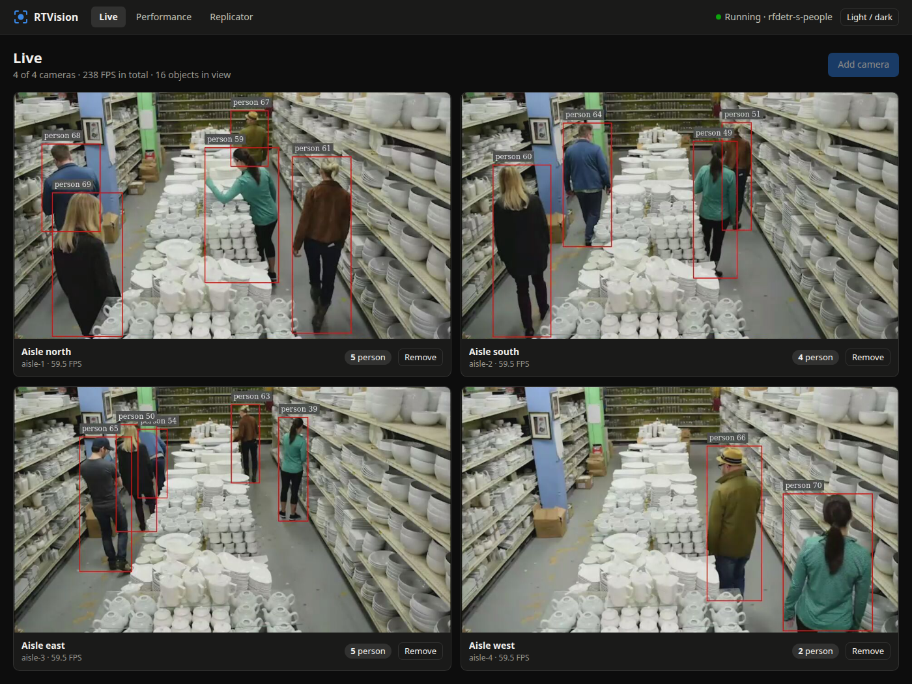
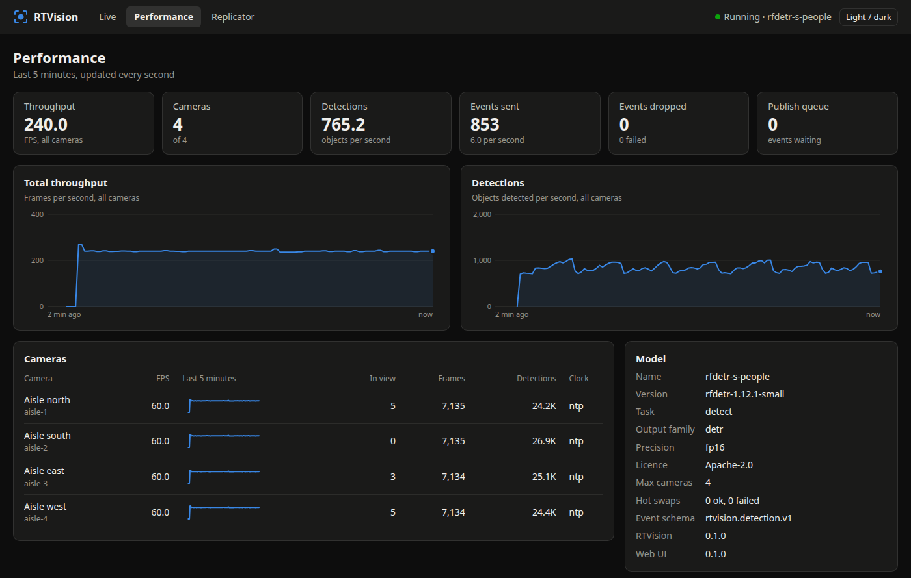
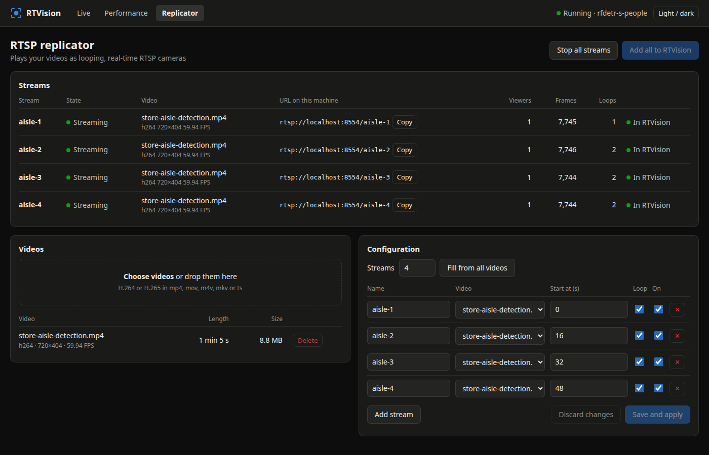

<!-- SPDX-License-Identifier: Apache-2.0 -->
# Web UI

```bash
docker compose -f deploy/compose/compose.yaml -f deploy/compose/compose.ui.yaml up -d --build
```

Open <http://localhost:8080/>.

| Page | Shows |
|---|---|
| **Live** | one card per camera with boxes, labels and track ids; objects in view; add and remove cameras; click a card to enlarge it |
| **Performance** | throughput, detections, events, per-camera FPS, model details; at the bottom GPU, CPU, memory and disk |
| **Replicator** | upload videos, configure looping RTSP streams, start/stop, add them to RTVision ([REPLICATOR.md](REPLICATOR.md)) |

The overlay adds two containers from the same image (`ui`, `replicator`) and turns on RTVision's
annotated output (`outputs.rtsp`, tiled 1920x1080).







Video in the first picture: Intel sample-videos, CC-BY-4.0 ([details](images/README.md)). To
reproduce: [`examples/demo`](../examples/demo/README.md).

## How it works

- Boxes are drawn by DeepStream. RTVision serves one tiled, annotated video (RTSP); the UI server
  decodes it on the GPU and sends JPEG frames (15 FPS); the browser cuts out each camera's tile.
  The decoder runs only while someone watches.
- Figures come from the ops server: `/metrics`, `/info` and `/events/latest`. "In view" is the last
  event of each camera, unless it is older than about one and a half publish intervals.
- Hardware figures come from `nvidia-smi` and `/proc` of the host running the UI container.
- Plain HTML/CSS/JavaScript and the Python standard library: no build step, no downloads at run
  time, works offline.

## Settings

| Setting | Meaning |
|---|---|
| `RTVISION_UI_PORT` (8080), `RTVISION_BIND` (127.0.0.1) | where the UI is published |
| `RTVISION_UI_ALLOWED_HOSTS` | host names, besides `localhost` and IP addresses, it may be opened with |
| `RTVISION_UI_PREVIEW_FPS` | frame rate of the live video (15) |
| `rtvision-ui --help` | all options, for running it without compose |

## Security

There is **no login**: anyone who can open the page can see the cameras and add or remove them.
It is published on `127.0.0.1` only; for other machines put a reverse proxy with authentication in
front of it. Requests that change something need a header other web sites cannot send, the `Host`
header is checked against DNS rebinding, and a strict content security policy applies. Camera URLs
(which can contain passwords) are never sent to the browser; the URLs of cameras added in the UI
are stored in a private file (volume `rtvision_ui-state`) because DeepStream needs the exact URL to
remove a camera.

## Limits

- The tiled video has one tile per `service.max_streams` slot: with many cameras each tile is
  small. Raise `outputs.tiled.width`/`height` (compose.ui.yaml).
- The live video costs one GPU encode (RTVision) and one decode (UI), measured at about 4 % encoder
  and 9 % decoder load for 4 cameras on an RTX 5070 Ti Laptop GPU.
