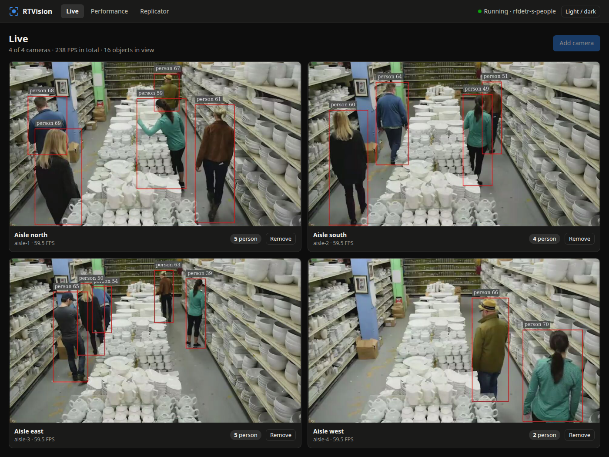

<!-- SPDX-License-Identifier: Apache-2.0 -->
# Demo: people detection on four cameras

One openly licensed online video becomes four looping RTSP cameras; RTVision detects and tracks the
people in them; the web UI shows the result.



## Requirements

See the [README](../../README.md#requirements): NVIDIA GPU with driver 595 or newer, Docker with
Compose v2, NVIDIA Container Toolkit, about 35 GB of disk, `curl`, Python 3.10+ with `venv`.
Ports 8080, 8554, 9000, 9094 and 9464 must be free on `localhost`.

## Run it

From the repository root:

```bash
# 1. Once: export the detector (RF-DETR Small, Apache-2.0) to ONNX. CPU only, a few minutes.
tools/export/rfdetr/export.sh

# 2. Download the video (9 MB), build and start everything, add four cameras.
#    The very first build pulls the DeepStream base image (~28 GB).
examples/demo/run_demo.sh
```

Expected end of the output (the numbers vary):

```
==> adding the cameras to RTVision
    Aisle north   60.0 FPS  {'person': 3}
    Aisle south   60.0 FPS  {'person': 5}
    Aisle east    60.0 FPS  {'person': 4}
    Aisle west    60.0 FPS  {'person': 5}
```

Then open:

| | |
|---|---|
| <http://localhost:8080/live> | four views with boxes, labels, track ids and people counts; click one to enlarge it |
| <http://localhost:8080/performance> | frame rates, detections, model; hardware at the bottom |
| <http://localhost:8080/replicator> | the video and the four streams: change, add, stop and start them |
| `rtsp://localhost:8554/aisle-1` … `aisle-4` | the cameras themselves, e.g. in VLC |

People count per camera from Kafka, in a terminal:

```bash
docker compose -p rtvision-demo exec -T kafka /opt/kafka/bin/kafka-console-consumer.sh \
  --bootstrap-server kafka:9092 --topic people-raw | python3 examples/consumer/occupancy.py
```

```
2026-11-23T08:19:00.016Z  aisle-1  people=3
2026-11-23T08:19:00.017Z  aisle-2  people=6
```

Stop it:

```bash
examples/demo/run_demo.sh stop     # keeps the engine cache, so the next start takes seconds
examples/demo/run_demo.sh clean    # also deletes the demo's volumes and the downloaded video
```

## What to expect

Measured on an RTX 5070 Ti Laptop GPU (driver 595): 4 × 60 FPS = 240 FPS, about 32 % GPU load,
1.3 GB of GPU memory, no dropped events. The first start takes about a minute (TensorRT engine
build), later ones about 20 s.

## What the script does

1. Downloads the video to `~/.cache/rtvision-demo` and checks its SHA-256.
2. Starts `deploy/compose/compose.yaml` + `compose.ui.yaml` as the separate compose project
   `rtvision-demo`, so it never touches the data of a normal RTVision stack.
3. Through the web UI's API: uploads the video, configures four streams that start 0, 16, 32 and
   48 s into it, and adds them as cameras.

The same by hand, without the script:

```bash
RTVISION_MODEL=rfdetr-s-people docker compose -p rtvision-demo \
  -f deploy/compose/compose.yaml -f deploy/compose/compose.ui.yaml up -d --build
```

then on the *Replicator* page: upload a video, *Fill from all videos*, *Save and apply*, *Add all to
RTVision*. Use any H.264/H.265 video of your own.

## Settings

| Variable | Default | |
|---|---|---|
| `DEMO_MODEL` | `rfdetr-s-people` | `rfdetr-s-coco` detects all 80 COCO classes |
| `RTVISION_UI_PORT` | `8080` | port of the web UI |
| `REPLICATOR_PORT` | `8554` | RTSP port on the host |
| `DEMO_CACHE` | `~/.cache/rtvision-demo` | where the video is kept |

## Problems

| Message | Fix |
|---|---|
| `the model is not exported yet` | run `tools/export/rfdetr/export.sh` |
| `docker compose failed`, `port is already allocated` | stop the other RTVision stack, or set `RTVISION_UI_PORT` / `REPLICATOR_PORT` |
| `not ready after 10 minutes` | `docker compose -p rtvision-demo logs rtvision`, see [TROUBLESHOOTING](../../docs/TROUBLESHOOTING.md) |
| `checksum mismatch` | the download was damaged; run the script again |

## Video credit

[`store-aisle-detection.mp4`](https://github.com/intel-iot-devkit/sample-videos/blob/57978890822836f2b4743852f04f62fc511757e4/store-aisle-detection.mp4)
by Intel Corporation, from [sample-videos](https://github.com/intel-iot-devkit/sample-videos),
licensed under [CC-BY-4.0](https://creativecommons.org/licenses/by/4.0/). It is downloaded at run
time from a pinned commit and is not part of this repository. The screenshot above shows frames of
it, scaled and annotated.
